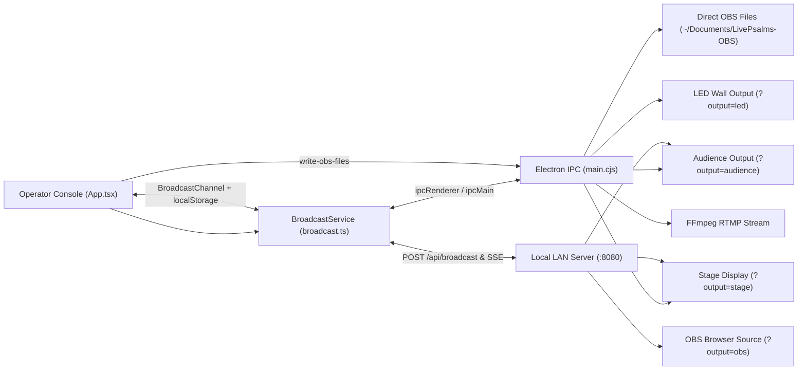

# Live Psalms — System Documentation

**Organization / Maintainer:** FrankSpace_KE  
**Repository:** `https://github.com/fr4nk1-3/Live-Psalm`  
**Platforms:** Windows (`NSIS` Installer & Portable `.exe`), Linux (`Ubuntu/Debian amd64 .deb`), Browser/LAN Client  

---

## 1. System Overview

**Live Psalms** is a church presentation, worship lyric, scripture projection, and live-streaming desktop application developed for **FrankSpace_KE**. It provides a multi-screen operator console with real-time synchronized outputs for congregation projectors, stage confidence monitors (near and long-distance), LED walls, OBS Studio overlays, and LAN-connected browser displays.

### Technology Stack
| Layer | Technology |
| :--- | :--- |
| **Desktop Shell** | Electron `^32.0.0` (`electron/main.cjs`) |
| **Frontend UI** | React `^18.3.1`, TypeScript `^5.6.3`, Tailwind CSS `^3.4.14`, Lucide Icons (`lucide-react`) |
| **Build & Bundling** | Vite `^5.4.10`, `electron-builder` `^24.13.3` |
| **Client Persistence** | `localStorage` (settings, playlists, songs, themes, quick pins) + `IndexedDB` (`mediaVault.ts` for user-uploaded videos/images/audio/logos) |
| **Streaming & OBS** | Native FFmpeg RTMP child process + Direct OBS Text/JSON file writer + Built-in HTTP LAN server (`:8080`) |
| **CI/CD** | GitHub Actions (`.github/workflows/release.yml`) |

---

## 2. System Architecture



### Multi-Channel State Synchronization
`BroadcastService` ([src/services/broadcast.ts](file:///home/frank/Documents/Projects/Live%20Psalms/src/services/broadcast.ts)) keeps all open windows and network clients synchronized using three layers:
1. **`BroadcastChannel` (`live_psalms_broadcast_v1`)** — instant same-origin browser/Electron messaging.
2. **Electron IPC (`broadcast-payload`)** — relays payloads across separate `BrowserWindow` instances in `electron/main.cjs`.
3. **Local LAN HTTP Server (`:8080`)** — serves the built `dist/` bundle plus `/api/broadcast` and `/api/stream` (Server-Sent Events) so external devices (tablets, stage laptops, OBS browser sources) receive live updates over Wi-Fi/LAN.

---

## 3. Repository & Module Structure

### Root & Packaging
- [package.json](file:///home/frank/Documents/Projects/Live%20Psalms/package.json) — npm scripts (`dev`, `build`, `build:win`, `build:deb`, `release:all`) and `electron-builder` configuration.
- [electron/main.cjs](file:///home/frank/Documents/Projects/Live%20Psalms/electron/main.cjs) — Electron main process, frameless multi-display window manager, LAN HTTP server (`8080`), OBS file writer, and FFmpeg RTMP streaming IPC handlers.
- [electron/linux-after-install.sh](file:///home/frank/Documents/Projects/Live%20Psalms/electron/linux-after-install.sh) — Debian `postinst` script creating the `/usr/bin/live-psalms` `--no-sandbox` wrapper, patching the `.desktop` launcher, and refreshing GTK icon/desktop caches.
- [build/icons/](file:///home/frank/Documents/Projects/Live%20Psalms/build/icons) — Linux hicolor PNG icons (`16x16` through `512x512`).
- [public/icon.png](file:///home/frank/Documents/Projects/Live%20Psalms/public/icon.png) & [public/icon.ico](file:///home/frank/Documents/Projects/Live%20Psalms/public/icon.ico) — Circular metallic badge app icons for Electron & Windows.
- [.github/workflows/release.yml](file:///home/frank/Documents/Projects/Live%20Psalms/.github/workflows/release.yml) — Automated Windows & Ubuntu `.deb` build and `v1.1.0` release upload pipeline.

### Frontend (`src/`)
- **Entry & State Orchestration:** [src/App.tsx](file:///home/frank/Documents/Projects/Live%20Psalms/src/App.tsx) — routes `?output=audience|stage|led|obs` or renders the main operator console.
- **Operator Console Components (`src/components/`):**
  - `Header.tsx` — Top bar with Quick Mode, Sermon Mode, Slide Canvas, Output toggles (`Audience`, `Stage`, `LED Wall`), Stream modal, Export/Import service package, and Settings.
  - `PlaylistPanel.tsx` — Service order management, drag/reorder, item actions, and quick-pin support.
  - `LibraryTabs.tsx` — Songs, 45+ Offline Bibles, Media/Backgrounds, and Themes library browser.
  - `CenterWorkspace.tsx` — Dual Preview / Program (`ON AIR`) 16:9 monitors, slide grid, section jump tags, and per-verse live/pin/translation controls.
  - `InspectorPanel.tsx` — Slide styling, theme overrides, speaker notes, and item properties.
  - `BottomControlBar.tsx` — Emergency overrides (`Black`, `Clear`, `Logo`, `Freeze`, `Stop Media`), duration & system-clock-linked countdown timer options (custom event headings, saved presets, target date/time), stage messages, and audience alerts.
  - `MediaPlayerBar.tsx` — Master transport bar (play/pause, seek, speed, volume, loop) synchronized to output windows.
- **Output Window Components (`src/components/`):**
  - `AudienceOutputWindow.tsx` — Fullscreen congregation projection with motion/image backgrounds, scrim/blur, transitions (`cut`, `fade`, `dissolve`, `slide`, `zoom`), lower-third mode, nursery/parent alert pager, announcement crawl, and full-slide countdown.
  - `StageDisplayWindow.tsx` — Stage confidence monitor supporting **Near Stage** (current slide, next slide, speaker notes, timer/clock) and **Far Stage** (high-contrast deep-midnight glassmorphic layout focused on the live slide, giant counter, and Book/Verse/Translation badges).
  - `LedWallOutputWindow.tsx` — Dedicated LED wall display output.
  - `ObsOutputWindow.tsx` — Chroma/alpha-capable browser source output for OBS Studio.
  - `FullscreenVideoPlayer.tsx` — Output video playback helper.
- **Modals (`src/components/`):**
  - `SettingsModal.tsx`, `BibleBookVerseModal.tsx`, `BibleVersionModal.tsx`, `GlobalSearchModal.tsx`, `QuickPresentationModal.tsx`, `SermonModeModal.tsx`, `SlideDesignerModal.tsx`, `SongEditorModal.tsx`, `StreamingModal.tsx`.
- **Services & Utilities (`src/services/`, `src/utils/`, `src/types/`):**
  - `storage.ts` — `StorageService` managing persisted app data, settings, church profile, and offline Bible lazy-loading from `src/data/bibles/manifest.json`.
  - `mediaVault.ts` — `IndexedDB` binary blob store for user-uploaded videos, images, audio, and logos.
  - `importer.ts` — Service package and song/media import helpers.
  - `onlineBibleApi.ts` — Optional online Bible lookup client.
  - `fontSize.ts` & `useAutoFitFontSize.ts` — Resolution-aware typography scaling and DOM binary-search auto-fit hook (`useAutoFitFontSize`) preventing verse clipping on any screen size.
  - `types/presentation.ts` — Core TypeScript interfaces (`Slide`, `PlaylistItem`, `Theme`, `AppSettings`, `StageDisplayState`, `EmergencyState`, etc.).

---

## 4. Core Features

### 4.1 Multi-Display & Frameless Output Windows
- `electron/main.cjs` queries `screen.getAllDisplays()` and maps **Audience**, **Stage**, and **LED Wall** outputs to configured physical monitors (`Settings → Displays & Outputs`).
- Output windows launch **borderless and frameless** (`frame: false`, `fullscreen: true`, `Menu.setApplicationMenu(null)`).

### 4.2 Stage Display Modes (`Near` vs `Far`)
Configured in **Settings → Displays & Outputs → Stage Display Mode**:
- **Near Stage (Confidence):** Full confidence monitor showing Current Slide, Upcoming Next Slide, Speaker/Stage Notes, and top Clock/Countdown bar.
- **Far Stage (Slide & Counter Focus):** Optimized for long-distance sanctuary/balcony visibility with a deep-midnight canvas, glassmorphic top bar, prominent **Book, Chapter:Verse & Translation** badges (e.g., `John 3:16` + `NKJV`), giant tabular-nums **Counter/Clock**, and an auto-fitted Hero Slide card.

### 4.3 Dynamic Auto-Fit Verse Scaling
- `getOutputFontSize` and `getFlexibleFontSize` (`src/utils/fontSize.ts`) scale text based on character length and line breaks.
- `useAutoFitFontSize` (`src/utils/useAutoFitFontSize.ts`) measures rendered `scrollWidth` / `scrollHeight` against container bounds via `ResizeObserver` and binary-searches for the largest non-overflowing pixel size.

### 4.4 Countdown Timer & System-Clock Target Mode
- **Preset & Custom Full-Slide Headings:** Supports built-in presets (`Service`, `New Year`, `Worship`, `Sermon`, `Conference`, `Break`, `Prayer`), editable active/completion headings, and user-saved custom presets persisted in `localStorage` (`live_psalms_countdown_presets_v1`).
- **System-Clock-Linked Target Time:** Operators can link the countdown to a specific OS clock target (`datetime-local` or 1-click **Midnight**, **New Year Jan 1 00:00**, **Next Hour**). Remaining time is computed directly from `Date.now()` to prevent drift, with multi-day formatting (`Xd HH:MM:SS`) across the operator bar, Audience Output, and Stage Display.

### 4.5 Offline Bible Engine (45 Translations)
Bundled in `src/data/bibles/` and indexed by [src/data/bibles/manifest.json](file:///home/frank/Documents/Projects/Live%20Psalms/src/data/bibles/manifest.json):
- **English:** BSB, KJV, NKJV, NIV, ESV, NLT, NASB, CSB, HCSB, NRSV, RSV, AMP, AMPC, LSB, NET, MEV, GNT, GW, TLB, TPT, NIrV, ERV, EASY, ASV, Darby, YLT, Tyndale, NASU.
- **East African / Kenyan Languages:** Swahili (`SUV`, `RSUV`), Kalenjin (`KLJ19`, `KLJ`, `KLJR`), Kamba (`KMB`, `MBV`), Kikuyu (`GKY13`, `GKY14`, `GKY19`), Luo (`LUO85`, `LUO15`, `LUO20`), Maasai (`MAS70`, `MAS20`, `MAS`, `MAS-MBS`).
- Supports **single-verse Live / Pin / Translation** actions as well as **parallel translations**.

### 4.6 OBS Studio & Live Streaming Integration
- **Direct OBS Files:** Writes `live_title.txt`, `live_slide.txt`, `live_subtitle.txt`, `live_combined.txt`, `lower_third.txt`, and `obs_state.json` to `~/Documents/LivePsalms-OBS`.
- **Browser Source:** `http://<LAN-IP>:8080/?output=obs` (supports transparent/alpha background mode).
- **RTMP Streaming:** Checks `ffmpeg` availability (`check-ffmpeg`) and streams via `start-stream` / `stop-stream` IPC handlers.

---

## 5. Build, Packaging & Deployment

### Local Commands
```bash
# Development server
npm run dev

# TypeScript check + Vite production bundle
npm run build

# Windows NSIS Setup + Portable .exe
npm run build:win

# Ubuntu/Debian amd64 .deb
npm run build:deb

# Build both Windows & Debian and upload to GitHub v1.1.0
npm run release:all
```

### Automated GitHub Releases
Pushing to `main` triggers `.github/workflows/release.yml`, which builds on both `windows-latest` and `ubuntu-latest` (`electron-builder --publish never`) and uploads:
- `LivePsalms-Setup.exe`
- `LivePsalms-Windows-Portable.exe`
- `LivePsalms-Ubuntu-amd64.deb`

to the `v1.1.0` (`Latest`) GitHub Release.
